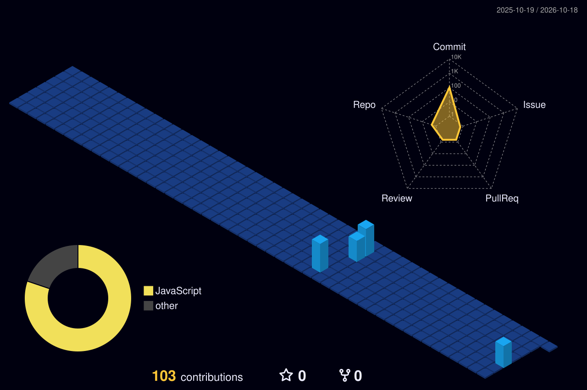

  

   

  

    

  
  

    

  

## > whoami

python
class LuizGustavo:
    def __init__(self):
        self.name = "Luiz Gustavo"
        self.role = "Back-End Developer in Progress"
        self.languages = [
            "Python",
            "JavaScript",
            "Java"
        ]
        self.database = ["MySQL"]
        self.tools = [
            "Git",
            "GitHub",
            "Linux"
        ]

    def motto(self):
        return "Learn. Build. Improve."

me = LuizGustavo()
print(me.motto())

 

Atualmente, estou focado em evoluir minhas habilidades em desenvolvimento Back-End, construir projetos práticos e aprender novas tecnologias. Meu objetivo é transformar conhecimento em soluções reais, escrevendo código cada vez mais organizado e eficiente.

---

## > tech_stack

  

    

  
  
  
  

## > github_stats

  

  

    

  

## > 3d_contributions

  

## > snake.exe

  <picture>
    <source media="(prefers-color-scheme: dark)" srcset="https://raw.githubusercontent.com/LuizGustavo139/LuizGustavo139/output/github-snake-dark.svg"/>
    <source media="(prefers-color-scheme: light)" srcset="https://raw.githubusercontent.com/LuizGustavo139/LuizGustavo139/output/github-snake.svg"/>
    
  </picture>

## > current_mission

- Desenvolver projetos que resolvam problemas reais.
- Evoluir na lógica de programação e no desenvolvimento Back-End.
- Aprender a construir APIs e trabalhar com bancos de dados.
- Aplicar boas práticas e escrever código limpo.
- Explorar novas tecnologias e compartilhar minha evolução.

## > featured_projects

  

## > connect()

  

    

  

  Building my future, one commit at a time.

